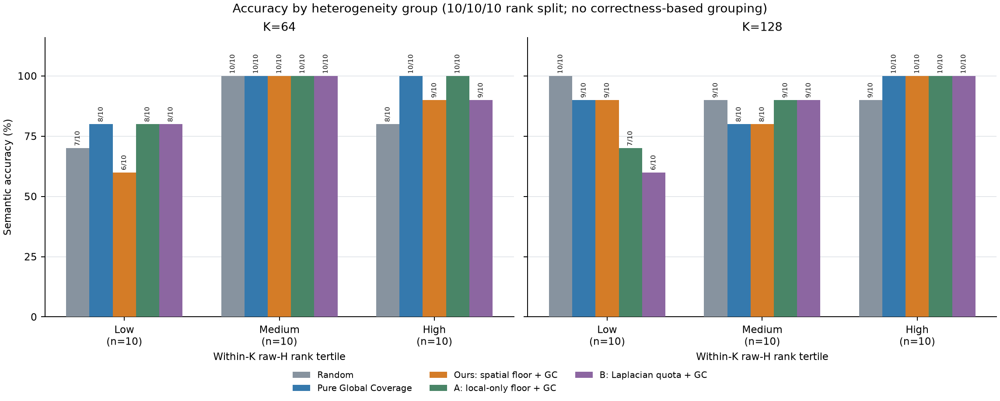

# VLM Token Efficiency

SmolVLM에서 시각 토큰을 줄이면서 객체 존재 판정에 필요한 단서를 얼마나 보존할 수 있는지 살펴본 연속 연구다. 연구마다 공간 보장, 예산 할당, 대표 토큰 선택을 각각 다뤘다.

| 연구 | 핵심 질문과 방법 |
|---|---|
| [Study1 · Coverage와 공간 하한](research/first_study/README.md) | 질문 비의존 표현 Coverage에서 최소 지역 대표를 두는 것이 도움이 되는가? Global Coverage와 공간 하한을 비교했다. |
| [Study2 · 지역 예산 할당](research/second_study/README.md) | K64에서 지역별 예산을 Coverage로 배정하는 것이 Laplacian 배정에 도움이 되는가? 공통 ERC 기반 선택·Decoder 아래 비교했다. |
| [Study4 · 공간 대표 선택](study4/README.md) | 질문 가중 Coverage에서 같은 K64로 공간 보장과 대표 선택 기준을 바꾸면 무엇이 달라지는가? 첫 Prefill 전에 Visual64로 압축했다. |

## Study4 대표 결과

SmolVLM-256M-Instruct, 공식 POPE Random Dev100 이미지 100장·600문항, pruned 조건 Visual K64. Full은 모든 시각 토큰을 사용했다.

| 방법 | Strict Accuracy | Strict F1 |
|---|---:|---:|
| Full | 86.33% | 84.47% |
| A · CoverPruner-style Global Coverage | 65.83% | 48.10% |
| D · Grid-Query Attention | 69.17% | 55.42% |
| F · Grid-Constrained Coverage | 63.67% | 42.93% |

D−A는 Accuracy **+3.33%p**, F1 **+7.32%p**였다. Accuracy 차이의 이미지 단위 paired bootstrap 95% CI는 **[+0.67, +6.17]%p**였다. A는 SmolVLM 이식 기준선이다. F는 A보다 정확도가 낮았다. 이 비교는 Dev100 탐색적 평가이며 독립 Test를 수행하지 않았다. 종단간 가속은 확립되지 않았다. [최종 보고서](study4/docs/STUDY4_FINAL_RESEARCH_REPORT.md) · [한국어 요약](study4/docs/STUDY4_RESEARCH_SUMMARY.md) · [결과표](study4/results/performance.csv)

A는 전역 greedy 64개를 선택한다. B–F는 5×5 셀당 한 개씩 선택한 뒤 동일 Coverage로 39개를 추가한다. 대표 선택 기준은 중심 거리(B), 코사인 medoid(C), 질문 Attention(D), Vision Attention(E), 공간 제약 Coverage(F)다. [방법과 실행 조건](study4/README.md)

## 재현과 자료

Study4의 합성 CPU 테스트와 집계 검산은 공개 파일로 실행할 수 있다. 기존 평가 환경은 GTX 1660 SUPER, Python 3.11, PyTorch 2.13.0+cu126, Transformers 5.15.1이며 Study4는 Batch1 No-Padding·SDPA·FP16을 사용했다. 공개본의 전체 GPU 재생에는 별도 연구 입력과 Runner가 필요하다. 모델·주석·이미지는 각 공식 출처에서 받는다. [Study4 재현 절차](study4/README.md#재현) · [SmolVLM](https://huggingface.co/HuggingFaceTB/SmolVLM-256M-Instruct) · [COCO](https://cocodataset.org/#download) · [POPE](https://github.com/RUCAIBox/POPE)

---

## 기존 Study1·Study2 공개 기록

아래는 이전 공개 시점의 README 기록이다. 본문의 상태 표기는 당시 시점을 기준으로 한다.


# VLM Token Efficiency — 1차·2차 연구

기존 1차 공개 커밋66bbfaf를 보존하고, 후속1차80이미지 결과와2차 S0–S4-A 결과를 별도 공개 view로 추가하는 검토안이다. Commit·Push는 아직 하지 않았다.

- [1차 후속800/320 결과](research/first_study/README.md) · 기존 30이미지 파일럿 원문은 아래에 그대로 보존.
- [2차 연구 S0–S4-A](research/second_study/README.md) · [S3-C 본 평가](research/second_study/reports/S3C.md) · [S4-A 원인 분석](research/second_study/reports/S4A.md).
- [현재 공개 범위·권리/의존성 HOLD](docs/SECOND_STUDY_RELEASE_SCOPE.md) · [새 후보 목록](docs/publication/FILE_LIST.md).

기존 루트 PUBLICATION_MANIFEST.json은66bbfaf의 역사적 snapshot 기록으로 보존한다. 현재 추가 안내가 붙은 README와 새 후보의 hash는 docs/publication/UPLOAD_MANIFEST.json에서 구분한다.

## 2차 본 평가 핵심 결과

SmolVLM-256M-Instruct, GTX1660 SUPER6GB, FP16/eager, batch1, greedy16. Pruning은 Local48+Global16=K64, Local4×4와 공통 Layer-0 ERC/Cell/Global 규칙을 사용했다. 네 방법의 고정200이미지·1200문항·4800 Generation이 완료됐다. 새 준비 과정에서는 GPU/Generation을 하지 않았다.

|방법|Semantic Accuracy|Semantic F1|Invalid/1200|
|---|---:|---:|---:|
|Full|83.333%|85.481%|78|
|S2-L|80.917%|83.470%|54|
|S2-U|80.583%|83.226%|55|
|S2-C|80.250%|82.904%|57|

주 비교 C−L F1은 **−0.566%p**, 기존 image-paired bootstrap95%CI **[−1.575,+0.432]%p**다. Coverage Allocation의 성능 우위는 확인되지 않았다. 공식 POPE Random 부분집합이며 전체 benchmark 점수가 아니다. Invalid를 분모에서 제거하지 않는다.

S0구조/설계→S1 CPU→S2 Full/No-op/Pruning 기능→S3 데이터 고정·다양한 구조 검증·파일럿·본 평가→S4-A CPU 원인 분석으로 진행했다. C의 임시Coverage32 중 최종Local48 보존은평균2.625개였고, C/L 정답 변화는11개 개선·19개 악화였다. 후속 후보는 목적 전달/객체 정렬·demand 범위·생성 길이 민감도이며 아직 실행하지 않았다.

**S²Prune-inspired SmolVLM adaptation**이다. 원본 Qwen S²Prune/CoverPruner 전체 재현으로 표기하지 않는다. 권리/의존성 HOLD 코드는 제외하고, 자체 CPU 평가 요약 부분만 제공한다. 현재 공개 범위는 aggregate-only 재현이며 원시 응답의 Parser 재실행이나 full GPU 실행을 제공하지 않는다.

```console
python -B tools/reproduce_summary_cpu.py
```

위 명령은200개 이미지의 저장 count vectors로 본 평가 지표를 검산한다. NumPy가 필요하며 모델/HOLD-helper import와 다운로드·GPU·Generation·파일 쓰기를 차단한다. `--bootstrap` 옵션은 별도로 기존10000회·seed42 CI를 재계산하며, 이번 정리에서는 실행하지 않았다. [소형 데이터와 재현 한계](research/second_study/README.md).

기존 LICENSE/NOTICE와 MMTok 저작권·SPDX 고지는 유지한다. [기존 라이선스 범위](docs/LICENSING.md)와 [이번 추가 범위](docs/SECOND_STUDY_RELEASE_SCOPE.md)를 구분한다. 원본 C 작업 폴더·로컬 변경·기존 실험 결과는 이동/수정하지 않았다.

---

## 아래는66bbfaf의 1차 README 원문 — 본문 그대로 보존

과거의 파일 수·준비/실행 상태는 원래 공개 시점의 기록이다. 현재 추가 공개 범위는 위 링크와 addendum을 따른다.

# Visual Token Pruning: Representational Coverage and Spatial Floors

**Phase-one research snapshot | historical 30-question pilot**

Can query-independent representational coverage preserve enough visual evidence for a small vision-language model, and does a minimum spatial allocation help? This personal research project studies that question with SmolVLM-256M-Instruct. It connects projected visual-token selection to actual language-model sequence shortening, checks the inference path, and examines failures rather than assuming spatial coverage guarantees answer quality.

**Main finding:** Spatial Floor + Global Coverage (Ours) guarantees local-region support, but is **not consistently better than Pure Global Coverage** on the fixed pilot. Ours scores 25/30 versus Pure GC 28/30 at K=64; both score 27/30 at K=128. These are exploratory results, not official full-POPE benchmark scores.

## Release scope

This phase-one research snapshot contains 72 selected files and is authorized
for GitHub publication. No experiment or test suite was run to prepare it.
Publication completion is established by remote verification, not assumed here.

- Random, Pure Global Coverage, Ours, shared inference/auditing/evaluation
  source and selected tests are included.
- The A/B coverage engine accepts externally supplied quotas. The image-to-quota
  orchestration and historical five-method runner remain withheld.
- The S2Prune reference implementation and ten associated files stay on HOLD.
  Rights HOLD and dependency HOLD are distinguished in [CODE_AVAILABILITY](docs/CODE_AVAILABILITY.md).
- Model weights/cache, dataset annotations/manifests, raw predictions,
  original images and photograph-containing figures are not included.
- Apache-2.0 applies within the file-level scope in [LICENSING](docs/LICENSING.md).
  MMTok attribution and changes are recorded in [NOTICE](NOTICE).
- Existing [vlm.py](vlm.py) is retained byte-for-byte from its GitHub source.
  Its license treatment is stated explicitly in LICENSING.

The five-method results below are historical numerical evidence. They do not
mean the full historical evaluation can be replayed from this release.
See [included files](PUBLIC_FILES.md), [exclusions](EXCLUSIONS.md), and
[release/privacy scope](docs/ETHICS_AND_RELEASE_SCOPE.md).

## Background and related work

Visual token pruning reduces the sequence passed to a VLM's language model. Attention, similarity, query relevance and spatial structure motivate different selection rules. This project separates an embedding-space coverage objective from a local minimum-allocation constraint.

The implementation history references MMTok's vectorized greedy coverage structure and S2Prune's spatial allocation ideas. CoverPruner attribution for the row-centered affinity remains unverified in the retained evidence. A 20-paper local literature inventory is documented with separate review states; file possession is not treated as completed reading. See [Literature Review](docs/LITERATURE.md).

## Methods

For projected visual embeddings V in R^(N x D), normalize each row and define:

```text
U = L2Normalize(V.float())
M = U @ U.T
A = clamp(M - M.mean(dim=1, keepdim=True), min=0)
F(S) = sum_i max_{j in S} A[i,j]
```

All demand weights are one. No query weighting is used. Greedy completion maintains current coverage, masks selected candidates with -infinity, and sorts only the final selection into the original visual-token order.

| Method | Candidate pool after seeding | Spatial rule |
| --- | --- | --- |
| Random | All local + global tokens | Fresh CPU Generator(seed=42) for each image/budget; randperm, keep K, sort |
| Pure GC | All local + global tokens | No floor or regional quota |
| Ours | All local + global tokens | One regional affinity medoid per local region, then free global completion |
| A: Local-only Coverage | Local tokens only | Same floor, affinity and all-N demand as B; free completion |
| B: Laplacian Quota | Local tokens only | Same A inputs/scorer; completion additionally constrained by final regional quotas |

B is an **allocation-only control**, not a full S2Prune reproduction: historical B inference uses neither recursive-cell selection nor actual ERC scores. A/B isolates the quota constraint; Ours/A isolates the completion candidate scope. Full definitions are in [METHODS](docs/METHODS.md).

## Model and experiment settings

| Item | Historical setting |
| --- | --- |
| Model | HuggingFaceTB/SmolVLM-256M-Instruct |
| GPU | NVIDIA GTX 1660 SUPER, 6 GB |
| Precision / attention | FP16 / eager |
| Runtime | Python 3.11.15; Torch 2.13.0+cu126; Transformers 5.15.1 |
| Data | Fixed original COCO POPE random subset: 30 questions, 15 Yes / 15 No, 30 distinct images |
| Selection / sampling seed | 42 |
| Budgets | K=64 with 4x4 regions (G=16); K=128 with 8x8 (G=64) |
| Decoding | Greedy, do_sample=False, max_new_tokens=16, num_beams=1, batch=1 |
| Prompt | Original annotation question, standard processor chat template, no appended answer instruction |
| Cache | Fresh KV-cache for each generation |
| Evaluation | Strict and visual_semantic_yes_no_v1; invalid is incorrect for accuracy |

See [recorded environment](environment/observed_versions.json) and [reproduction limits](docs/REPRODUCIBILITY.md). G only labels spatial diagnostics for Random/Pure GC; it constrains floor-based selectors.

## POPE 30-question results

Each cell is correct answers / 30. All 300 pruning generations completed in the historical experiment. Stored Full Model responses were reused, not regenerated for this comparison.

| Method | K64 Semantic | K64 Strict | K128 Semantic | K128 Strict |
| --- | ---: | ---: | ---: | ---: |
| Random | 25/30 | 19/30 | 28/30 | 19/30 |
| Pure GC | 28/30 | 22/30 | 27/30 | 21/30 |
| Ours | 25/30 | 23/30 | 27/30 | 24/30 |
| A: Local-only | 28/30 | 24/30 | 26/30 | 22/30 |
| B: Laplacian quota | 27/30 | 23/30 | 25/30 | 20/30 |

The stored Full Model baseline is **Semantic 26/30 (86.67%)** and **Strict 18/30 (60.00%)**. Its 12 strict-invalid responses fell to 2 after separate semantic rescoring of the same raw outputs. That change is a parser/evaluation change, not a new model result.

Semantic v1 was developed after examining output forms. Its function does not receive labels or question IDs, but held-out parser generalization is unverified. Strict results remain reported alongside it. See [RESULTS](docs/RESULTS.md) for invalid counts, paired outcomes and linked aggregate artifacts.

## Inference-path validation

Pruning is applied **after the vision encoder/projector and before LLM prefill**. Unselected visual placeholders are physically removed; all text, separators and other nonvisual tokens are retained. The selected embeddings and placeholders stay aligned and in original order.

Historical K=N gates on N=832 and N=1088 report exact input-embedding and first-step-logit equality (maximum absolute difference 0), identical generated token IDs and identical raw answers. Identity validates the plumbing, not answer correctness.

Actual Ours smoke examples demonstrate sequence shortening:

| Case ID | N | K | Original LLM sequence | Pruned / audited prefill length |
| --- | ---: | ---: | ---: | ---: |
| q2794 | 832 | 64 | 879 | 111 |
| q2794 | 832 | 128 | 879 | 175 |
| q1603 | 1088 | 64 | 1143 | 119 |
| q1603 | 1088 | 128 | 1143 | 183 |

These are stored historical measurements; no model was loaded for this preparation. Vision/projector computation still processes all N tokens. Debug-hook generation times are not end-to-end speedup measurements.

## Structural heterogeneity follow-up

The post-hoc analysis uses regional Laplacian-variance complexity and H = population_std(C) / (mean(C) + 1e-8), separately for the two K/grid configurations. Low/Medium/High groups contain 10 images each, ranked by (H, image ID, question ID), without using correctness.

- Ours has zero empty local regions at both budgets.
- Pure GC has mean 0.2 empty regions at K64 and 9.8 at K128.
- At K64, Pure GC already covers all regions on 25/30 images; all three Ours-only losses occur within that stratum.
- High heterogeneity does not establish a general Ours advantage. The stored Spearman H-versus-paired-correctness-difference values are approximately 0.1861 and 0.0000.



These photo-free plots were copied from the historical analysis. This is an S2Prune-inspired diagnostic, not a reproduction of its official heterogeneity figure. Nominal crop/token coordinates are not object masks or verified neural receptive fields. See [HETEROGENEITY](docs/HETEROGENEITY.md).

## Available functionality and reproduction boundary

| Task | Scope in this working copy |
| --- | --- |
| Read methods, source, aggregate JSON and anonymous CSV | Available without model/data downloads |
| Synthetic checks of Random/GC/Ours, adapters and parsers | Source provided; requires a compatible environment; not run during preparation |
| A/B synthetic engine checks with supplied quotas | Source provided; image-derived Laplacian quota workflow is withheld |
| Single-image pruning examples | Need a separately supplied image, compatible environment and model cache |
| Replay original POPE pilot/smoke | Requires withheld manifests, images and baseline/evidence artifacts |
| Replay all historical comparison generations | Not available: integrated runner, raw baseline/input artifacts and other dependencies are withheld |
| Recompute complete image-based H analysis | Not available: analysis runner/helper and original image inputs are withheld |
| Feed aggregate exports to historical raw-data tools | Not supported; aggregate schemas are not raw-prediction replacements |

The included test command is documentation only; it was not executed:

~~~console
python -B -m unittest discover -s tests -p "test_*.py" -v
~~~

Some tests import Transformers; tensor tests require Torch. Artifact-dependent
checks may skip without private inputs. Passing static import/AST inspection
does not establish runtime compatibility or a successful test suite.

### Example requirements and side effects

- `run_small_vlm.py` and `inspect_visual_tokens.py` may download model files;
  their loaders are not offline-safe by default and do not pin a revision.
- Other model examples require their documented local cache and inputs.
  Example defaults such as `images/meta.webp` and diagnostic photos are absent.
- `download_pope_pilot_images.py` performs network requests and writes reports
  if explicitly invoked. It was not invoked for this preparation.
- Plot/report utilities require the full historical schema and, for panels,
  original images. The exported aggregate files are not drop-in replacements.
- `vlm.py` is the original PyTorch/CUDA matrix-multiplication check. It is not
  the VLM inference entry point and is not a data-free static check.

No model, test, generation or benchmark ran during preparation. No automatic
transition to GPU evaluation is configured. See [REPRODUCIBILITY](docs/REPRODUCIBILITY.md).

## Limitations and open questions

- One model, a single fixed 30-question sample and one Random seed; no statistical or benchmark-wide superiority claim.
- K and G change together; the floor consumes 25% versus 50% of K.
- Coverage objective value, regional support and VQA accuracy measure different things.
- Object-specific evidence retention is unverified; zero-region counts do not prove object loss.
- Semantic parser generalization is unverified; answer-format effects must be separated from recognition failures.
- Original experiment code was untracked. Its execution commit is **not recorded**. No later commit is assigned retroactively.
- Public copies are incomplete derived records, not byte-identical historical configs or complete execution evidence.

Next work is proposed, not executed: cross K and G independently, match local/global budgets in downstream comparisons, use larger prespecified samples and additional seeds, validate object-coordinate evidence, and evaluate parsers on held-out responses.

## Documentation and provenance

- [Methods](docs/METHODS.md)
- [Results and evaluation contract](docs/RESULTS.md)
- [Heterogeneity analysis](docs/HETEROGENEITY.md)
- [Reproducibility and provenance](docs/REPRODUCIBILITY.md)
- [Literature and implementation references](docs/LITERATURE.md)
- [Release scope](docs/ETHICS_AND_RELEASE_SCOPE.md)
- [License scope](docs/LICENSING.md)
- [License text](LICENSE) and [attribution notices](NOTICE)
- [Public file manifest](PUBLICATION_MANIFEST.json)

The manifest separates original SHA-256 from public-copy SHA-256 and lists transformations. Local paths are not represented as externally accessible links. Initial preparation did not stage, commit or upload files. Publication uses a separate clone and preserves existing repository history; the publication commit is identified by Git history. No Notion update or model execution accompanies publication.

<!-- SPDX-License-Identifier: Apache-2.0 -->
<!-- Copyright 2026 dongeunk. Original project text only; external material retains its own rights. -->
