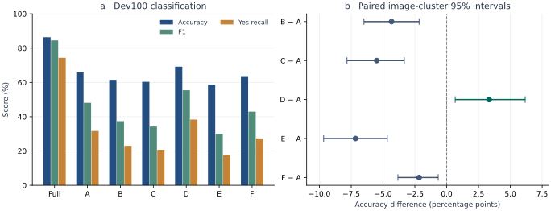

# 공간 제약과 질문 관련성이 시각 토큰 선택에 미치는 영향

**Study4 최종 연구 보고서 · SmolVLM-256M-Instruct · Dev100 탐색적 평가**

## 1. Abstract

VLM의 시각 토큰 수를 줄이면 Decoder가 처리하는 입력을 압축할 수 있다. 본 연구는 같은 시각 토큰 예산 K64에서 CoverPruner-style 전역 Coverage Greedy와 5×5 격자 기반 변형 다섯 가지를 비교했다. 공식 POPE Random의 Dev100(100장, 600문항)에서 Full과 여섯 선택 방법의 응답 4,200개를 검증했다. 격자별 질문 Attention으로 25개를 고른 D의 Accuracy와 F1은 69.17%와 55.42%였다. 전역 기준 A 대비 각각 +3.33%p와 +7.32%p였으며 Accuracy의 이미지 단위 paired bootstrap 95% 구간은 [+0.67, +6.17]%p였다. 공간 제약하에서 Coverage로 25개를 고른 F의 Accuracy는 63.67%로 A보다 낮았다. 모든 K64 조건에서 Full 대비 Yes Recall과 Accuracy가 크게 낮아졌다. Decoder Prefill 구간 단축은 관찰됐으며, 선택과 공유 계산을 포함한 계측으로는 일반적인 종단간 가속을 확립할 수 없었다. 독립 Test400 평가는 미실시 상태다. [Dev100 무결성 기록](../results/PROVENANCE.json) · [성능 CSV](../results/performance.csv)

## 2. Introduction

고해상도 이미지의 여러 crop과 thumbnail을 함께 입력하면 시각 토큰이 늘어난다. Decoder Prefill에서 더 긴 입력은 self-attention과 토큰별 계산을 늘리며, 이후 Decode에서도 더 많은 KV를 보관하고 참조하게 한다. 시각 토큰 Pruning의 목적은 이러한 부담을 줄이면서 질문에 답하는 데 필요한 시각 단서를 보존하는 것이다.

CoverPruner는 버려지는 토큰의 표현을 남은 토큰으로 얼마나 잘 대리할 수 있는지를 최적화한다. 전역 greedy의 목적함수는 특징 공간의 대리 가능성을 평가하며, 영상의 각 공간 구역에 토큰을 남기는 조건은 포함하지 않는다. 이번 연구는 K64에서 (1) 격자별 최소 한 개의 대표를 강제하면 객체 존재 판정이 개선되는지, (2) 같은 공간 보장 아래 대표를 고르는 기준에 따라 결과가 달라지는지 살폈다. 특히 동일한 Coverage를 처음부터 공간 제약하에 적용하는 F가 전역 A보다 더 많은 국소 단서를 보존할 가능성을 검토했다. [CoverPruner §3.2–3.4](https://arxiv.org/html/2609.03158v1) · [Study4 설계](#4-methodology)

## 3. Related Work

- **Coverage 기반 선택.** Zhu et al.의 *Who Speaks for the Pruned? Visual Token Pruning as Coverage Optimization*은 Projector 공간에서 후보 전체를 수요로 놓고 질문 관련성으로 가중한다. 남은 원본 토큰이 각 수요 토큰을 얼마나 잘 대리하는가를 최대화하며, 첫 Decoder 층의 Attention Probe를 사용한다. 이 연구의 수학적 기준은 arXiv v1이다. [CoverPruner](https://arxiv.org/abs/2609.03158v1)
- **공간 분산과 토큰 감축.** Shang et al.의 LLaVA-PruMerge는 중요 토큰을 고르고 유사 토큰의 정보를 병합한다. PruMerge+에는 공간적으로 균일한 토큰 보충이 있다. Study4는 원본 토큰 선택만 수행하며, 각 5×5 셀을 한 번씩 대표하는 초기 조건을 둔다. [LLaVA-PruMerge 연구 페이지](https://llava-prumerge.github.io/) · [논문](https://arxiv.org/abs/2403.15388)
- **Attention 기반 선택.** Chen et al.의 FastV는 초기 층에서 얻은 Attention에 따라 후속 층의 시각 토큰을 줄인다. Study4의 D는 첫 Decoder 층의 Q/K 관측을 초기 공간 선택에 활용하고, E는 Vision Encoder 내부의 incoming attention을 활용한다. 두 방법 모두 실제 언어 모델 Prefill 전에 토큰을 줄인다. [FastV](https://arxiv.org/abs/2403.06764)
- **객체 존재 평가.** Li et al.의 POPE는 객체 존재 여부를 Yes/No로 묻는 방식으로 객체 환각을 평가한다. Study4는 공식 Random 문항의 고정 부분집합을 사용했다. [POPE 논문](https://aclanthology.org/2023.emnlp-main.20/) · [공식 자료](https://github.com/RUCAIBox/POPE)

## 4. Methodology

### 4.1 공통 Coverage 목적함수

원본 Projector 토큰 전체를 수요와 선택 후보 집합 $V$로 두고, 각 임베딩 $v_i$를 FP32에서 $u_i=v_i/\max(\lVert v_i\rVert_2,10^{-12})$로 정규화한다. 원본 crop 및 thumbnail 토큰은 별개 후보로 유지한다. $r_i$는 질문 토큰에서 시각 위치 $i$로 향하는 첫 Decoder 층 Attention을 Query 토큰과 Query head에 걸쳐 평균한 값이다. $r_i$를 전체 후보에서 min–max 정규화한 $\hat r_i$와 $\tau=0.3$으로 수요 가중치 $w_i=\exp(\tau\hat r_i)$를 계산한다. 모든 $r_i$가 같으면 $\hat r_i=0$이다. [수학·정밀도 정책](VALIDATION.md#method-and-layout) · [Coverage CPU 검증](VALIDATION.md#historical-function-checks)

$$
M_{ij}=u_i^\top u_j,\qquad A_{ij}=\max\!\left(0,M_{ij}-\frac{1}{|V|}\sum_{k\in V}M_{ik}\right).
$$

$$
c_i(S)=\max_{j\in S} A_{ij},\qquad
F(S)=\sum_{i\in V}w_i c_i(S),\qquad
\Delta(j\mid S)=\sum_{i\in V}w_i\max(0,A_{ij}-c_i(S)).
$$

빈 집합은 $c_i=0$을 사용한다. 매 단계 미선택 후보에서 최대 $\Delta$를 고른 뒤 $c_i\leftarrow\max(c_i,A_{ij})$를 갱신한다. 점수가 정확히 동률이면 원본 시각 토큰 순서상 앞선 후보를 선택한다. B–F의 25개 대표를 확보한 뒤의 39회 greedy는 해당 집합의 $c_i$에서 이어진다. [공간 선택 설계](#4-methodology) · [공간 선택 CPU 검증](VALIDATION.md#historical-function-checks)

### 4.2 여섯 가지 선택 방법

각 Projector 토큰의 명목 중심을 원본 이미지의 하나의 5×5 셀에 대응시킨다. Local crop과 Global thumbnail은 동일 원본 좌표계를 사용한다. 이 격자는 B–F의 초기 대표에 적용되며, 39개 후속 토큰은 전체 후보에서 고른다. [공간 매핑](VALIDATION.md#method-and-layout)

| 방법 | K64 선택 알고리즘 |
|---|---|
| **A · Global Coverage Greedy64** | 빈 집합에서 시작해 전체 후보의 최대 한계이득을 64회 선택한다. |
| **B · Grid-Center25 + Greedy39** | 셀마다 토큰의 명목 중심과 셀 중앙의 원본 픽셀 거리 $(W\Delta x)^2+(H\Delta y)^2$가 최소인 토큰을 고른다. |
| **C · Grid-Medoid25 + Greedy39** | 셀 $C$마다 $\lvert C\rvert^{-1}\sum_{i\in C}M_{ij}$가 최대인 토큰 $j$를 고른다. 셀 내부 원시 코사인 평균은 자기 자신을 포함한다. |
| **D · Grid-Query Attention25 + Greedy39** | 셀마다 정규화 이전의 Query-to-Visual 관련성 $r_j$가 최대인 토큰을 고른다. |
| **E · Grid-Vision Attention25 + Greedy39** | 셀마다 마지막 Vision Encoder 층의 incoming attention이 최대인 토큰을 고른다. 점수는 view별로 head와 유효 query patch를 평균한 뒤, Projector 토큰에 대응하는 4×4 patch를 다시 평균한다. |
| **F · Grid-Constrained Coverage25 + Greedy39** | 빈 집합에서 시작해 아직 대표가 없는 모든 셀의 후보 중 최대 $\Delta(j\mid S)$를 고른다. 선택한 셀을 닫는 과정을 25회 반복한 뒤 셀 제약을 해제하고 기존 $S,c$를 유지한다. |

E의 Vision 점수는 seed 선택에만 사용한다. B–F 모두 후속 39개 선택에 공통 질문 수요 가중치와 Coverage를 적용한다. [A–F 설계](#4-methodology) · [Vision Attention 검증](VALIDATION.md#historical-function-checks)

### 4.3 CoverPruner 원문과 SmolVLM 이식

A는 동일한 계열의 Coverage 수학을 SmolVLM에 이식한 기준이다. 원문의 실험은 LLaVA 계열을 주로 사용했으며, Query Probe의 Softmax 분모, RoPE·마스크 세부, Pruning 이후 Position ID 정책은 Study4에서 별도로 결정했다. [CoverPruner 원문](https://arxiv.org/html/2609.03158v1) · [원문–이식 대조](VALIDATION.md#method-and-layout)

SmolVLM Probe는 압축 전 질문 입력의 첫 Decoder RMSNorm 및 Q/K projection을 관측한다. 원본 Position ID, Native RoPE와 causal mask를 적용하고, 각 query가 볼 수 있는 전체 prefix에서 softmax 한 뒤 시각 key 열만 추출한다. 행별 분모에는 유효한 비시각 key가 들어갈 수 있다. 질문 범위는 chat-template의 user body에서 명시적으로 추적한다. 질문 관련성 집계와 FP32 Coverage는 현재 이식의 수치 정책이다. E는 Native Vision Q/K에서 Attention 수식을 재구성했으며 SDPA의 Vision·Projector 특징 불변성을 확인했다. [Native Query Probe 검증](VALIDATION.md#historical-function-checks) · [Vision Attention 검증](VALIDATION.md#historical-function-checks)

선택 후 원본 Projector 값과 시각 토큰의 상대 순서를 유지하고 모든 비시각 토큰을 보존한다. 입력을 물리적으로 압축한 다음 연속 Position과 Native causal mask를 만들고, 빈 DynamicCache로 **첫 LLM Prefill**을 수행한다. Full은 원래 시각 토큰 전체를 사용하는 별도 dense Cold-KV 기준이다. [Cold-KV Decoder 검증](VALIDATION.md#historical-function-checks)

## 5. Experimental Setup

- **환경.** Windows, NVIDIA GeForce GTX 1660 SUPER, Python 3.11.15, PyTorch 2.13.0+cu126, Transformers 5.15.1. 기존 로컬 snapshot `7e3e67edbbed1bf9888184d9df282b700a323964`의 SmolVLM-256M-Instruct를 사용했다. Batch1 No-Padding, SDPA·FP16, greedy, max_new_tokens=10, 동일 Processor·질문·답변 지시를 사용했다. [실행 계약](../configs/evaluation.json) · [환경 기록](VALIDATION.md#historical-function-checks)
- **기능 검증과 평가 구조.** N576·N832·N1088의 A–F는 별도 GPU Smoke에서 검증했다. 실제 Dev100에는 N832 87장, N1088 13장이 포함됐다. N832의 3×4와 4×3 crop 순서는 실제 Processor와 일치하도록 확인했다. [N576 Smoke](VALIDATION.md#historical-function-checks) · [N832/1088 Smoke](VALIDATION.md#historical-function-checks) · [Pilot 좌표 검증](VALIDATION.md#historical-function-checks)
- **Dev100.** 기존 노출을 제외한 공식 POPE Random 풀에서 이미지 100장을 고정했다. 이미지당 공식 질문 6개(Yes 3·No 3), 총 600개 공유 문항이다. 7개 조건의 응답은 총 4,200개로, Pilot의 420개와 후속 3,780개를 포함한다. [Dev 고정 절차](VALIDATION.md#dev100-evidence) · [Dev Manifest 해시](../results/PROVENANCE.json) · [완료 지표·해시](../results/PROVENANCE.json)
- **파서.** 주요 Strict는 응답 전체에서 Yes 또는 No를 대소문자 구별 없이 인식하며 끝의 마침표 또는 느낌표 한 개를 허용한다. Invalid는 Accuracy에서 오답이다. 보조 Official-compatible은 첫 마침표 앞의 문자열에서 쉼표를 제거한 다음 공백 분리 토큰 `No`, `no`, `not`이 있으면 No, 그 외는 Yes로 처리한다. 이 보조 규칙은 모호한 응답을 Yes로 분류할 수 있다. [채점 계약](VALIDATION.md#dev100-evidence) · [공식 evaluate.py](https://github.com/RUCAIBox/POPE/blob/main/evaluate.py)
- **지표.** Accuracy $=(TP+TN)/600$. Yes Precision $=TP/(TP+FP)$, Yes Recall $=TP/(\mathrm{TP}+\mathrm{FN}+\mathrm{InvalidYes})$, No Recall $=TN/(\mathrm{TN}+\mathrm{FP}+\mathrm{InvalidNo})$, F1은 Yes Precision·Recall의 조화평균이다. Coverage와 A 대비 선택 토큰 교집합, 구간 시간과 GPU 메모리를 기록했다. [Dev100 계측·지표 정의](../results/README.md)
- **불확실성.** 이미지별 6문항을 한 cluster로 유지하고 동일한 이미지 샘플을 모든 방법에 사용했다. seed 20261124로 100개 이미지를 복원 추출하는 paired cluster bootstrap 10,000회를 수행했다. 표의 양측 95% percentile CI는 개별 비교 구간이며, 다중 비교 보정은 적용하지 않았다. [Bootstrap CSV](../results/cluster_bootstrap.csv)

## 6. Results

### 6.1 분류 성능

| 방법 | Accuracy | F1 | Yes Precision | Yes Recall | No Recall | TP | FP | TN | FN |
|---|---:|---:|---:|---:|---:|---:|---:|---:|---:|
| Full | 86.33% | 84.47% | 97.81% | 74.33% | 98.33% | 223 | 5 | 295 | 77 |
| A | 65.83% | 48.10% | 100.00% | 31.67% | 100.00% | 95 | 0 | 300 | 205 |
| B | 61.50% | 37.40% | 100.00% | 23.00% | 100.00% | 69 | 0 | 300 | 231 |
| C | 60.33% | 34.25% | 100.00% | 20.67% | 100.00% | 62 | 0 | 300 | 238 |
| D | 69.17% | 55.42% | 100.00% | 38.33% | 100.00% | 115 | 0 | 300 | 185 |
| E | 58.67% | 29.94% | 98.15% | 17.67% | 99.67% | 53 | 1 | 299 | 247 |
| F | 63.67% | 42.93% | 100.00% | 27.33% | 100.00% | 82 | 0 | 300 | 218 |

응답 4,200개에서 Strict Invalid와 두 파서의 판정 불일치는 모두 0건이었다. 따라서 이번 표본에서 Strict와 Official-compatible의 Accuracy와 F1은 일치했다. A와 D의 Yes 출력 비율은 각각 15.83%와 19.17%였다. Full은 38.00%였고 정답 Yes 비율은 50.00%였다. 최고 K64 조건 D도 Full 대비 Accuracy **−17.17%p**(95% CI [−20.00, −14.33]%p), F1 **−29.05%p**였다. [성능 CSV](../results/performance.csv) · [Bootstrap CSV](../results/cluster_bootstrap.csv)

### 6.2 A 대비 paired 변화

| 방향 | Δ Accuracy (%p) | 95% CI | Δ F1 (%p) | 95% CI | 정답→오답 | 오답→정답 |
|---|---:|---:|---:|---:|---:|---:|
| B−A | -4.33 | [-6.50, -2.17] | -10.70 | [-15.91, -5.56] | 37 | 11 |
| C−A | -5.50 | [-7.83, -3.33] | -13.85 | [-19.49, -8.45] | 38 | 5 |
| D−A | +3.33 | [+0.67, +6.17] | +7.32 | [+1.46, +13.60] | 16 | 36 |
| E−A | -7.17 | [-9.67, -4.67] | -18.16 | [-24.49, -12.09] | 51 | 8 |
| F−A | -2.17 | [-3.83, -0.67] | -5.17 | [-9.06, -1.55] | 18 | 5 |

차이는 반올림 이전의 값으로 계산했다. D는 A보다 정답이 20개 많았으며, 두 조건에서 모두 FP 0건이었다. D의 Yes Recall 증가는 +6.67%p(95% CI [+1.33, +12.33]%p)였다. 이미지 단위 Accuracy는 D가 A보다 높은 경우 28장, 동일한 경우 57장, 낮은 경우 15장이었다. Full에서 D로 전환하면 정답→오답 110건과 오답→정답 7건이 있었다. [Paired 변화 CSV](../results/paired_vs_A.csv) · [이미지별 CSV](../results/image_cluster_counts.csv) · [공개 집계 검산](../scripts/reproduce_dev100.py)

*그림 1. 왼쪽은 Dev100 Strict Accuracy·F1·Yes Recall, 오른쪽은 A 대비 Accuracy 차이와 이미지 단위 95% 구간이다. [벡터 PDF](figures/STUDY4_DEV100_RESULTS.pdf)*

### 6.3 Coverage와 선택 토큰

| 방법 | 평균 F(S) | 평균 Reference F(S) | 최대 절대오차 | A와 교집합 / 64 |
|---|---:|---:|---:|---:|
| A | 155.622396 | 155.622395 | 1.94e-5 | 64.00 |
| B | 152.644523 | 152.644523 | 1.92e-5 | 30.70 |
| C | 152.362426 | 152.362427 | 1.92e-5 | 32.30 |
| D | 151.265140 | 151.265140 | 1.81e-5 | 32.24 |
| E | 151.738352 | 151.738352 | 2.38e-5 | 30.41 |
| F | 155.236580 | 155.236580 | 2.13e-5 | 46.73 |

A–F의 최종 Coverage 3,600건에서 저장된 Reference와의 최대 절대오차는 $2.38\times10^{-5}$였다. 기준은 $10^{-3}+10^{-6}|F_{\mathrm{ref}}|$이며, B–F의 셀당 seed 1개 기록은 3,000건에서 확인했다. F는 A와 평균 46.73개를 공유해 변형 중 교집합이 가장 컸다. 이 Coverage는 질문 가중 Projector 특징의 합이며, 이미지의 공간 점유율이나 객체 단위 보존 수와는 다른 지표다. [Coverage CSV](../results/coverage_overlap.csv) · [Reference 정책](VALIDATION.md#historical-function-checks)

### 6.4 Latency와 GPU 메모리

| 방법 | Vision (s) | Probe (ms) | Selection (ms) | Prefill (ms) | Decode (ms) | 계상 E2E (s) | 구간 Peak allocated (MiB) |
|---|---:|---:|---:|---:|---:|---:|---:|
| Full | 4.903 | — | — | 432.04 | 57.34 | 10.791 | 657.50 |
| A | 4.904 | 7.52 | 89.07 | 72.82 | 56.79 | 10.569 | 512.61 |
| B | 4.904 | 7.52 | 55.81 | 107.82 | 57.94 | 10.864 | 512.61 |
| C | 4.904 | 7.52 | 56.23 | 112.58 | 58.05 | 11.352 | 512.61 |
| D | 4.904 | 7.52 | 55.39 | 231.10 | 58.09 | 12.111 | 512.61 |
| E | 4.759 | 7.52 | 55.75 | 261.72 | 58.10 | 12.965 | 512.61 |
| F | 4.904 | 7.52 | 105.86 | 302.83 | 57.93 | 14.097 | 512.61 |

Vision·Probe·Selection·Prefill·Decode 평균은 조건당 600문항의 저장 계측값이다. 계상 E2E는 조건당 540문항에서 Processor 시간, 공유 준비 비용의 방법별 배정, 각 방법의 wall time을 합한 값이다. Pilot 60문항에는 동일 E2E 계측이 없다. 공유 준비에는 검증과 E의 Vision 관측이 포함될 수 있고, 각 방법의 wall time에는 저장 부담이 포함된다. E의 별도 observer CUDA event 평균은 96.26ms이며, Vision 열은 관측을 포함한 구간이므로 이 값을 다시 더하지 않는다. 동일 Runner 순서와 공유 allocator에 영향을 받을 수 있는 계측이다. [Dev100 Latency·Memory CSV](../results/latency_memory.csv) · [계측 정의](VALIDATION.md#dev100-evidence)

Dev100에서 모든 K64의 평균 Decoder Prefill 시간은 Full의 432.04ms보다 낮았다. 방법별 저장 구간 peak allocated는 Full 657.50MiB, A–F 모두 512.61MiB였다. Peak reserved는 모든 방법에서 3,948MiB, 공유 준비의 최대 allocated는 2,609.50MiB였다. 계상 E2E는 A가 Full보다 0.222초 짧았고, B–F는 모두 더 길었다. 이러한 수치는 해당 평가 프로세스의 구간 진단과 계상값을 보여준다. 포괄적인 standalone 처리량, 반복 TTFT, 방법별 전체 VRAM 절감률은 이 자료에서 산출할 수 없다. [Dev100 Latency·Memory CSV](../results/latency_memory.csv)

GPU Smoke의 단회 시간은 별도 기능 자료다. 예를 들어 N832 A의 Prefill 113.1ms와 N1088 A의 314.4ms는 각각 한 번의 비평가 입력에서 기록됐다. 이 값은 위 Dev100 반복 관측의 평균 또는 속도 비교에 합산하지 않았다. [N576 기능 검증](VALIDATION.md#historical-function-checks) · [N832/1088 기능 검증](VALIDATION.md#historical-function-checks)

## 7. Discussion

1. **D가 A보다 높았던 이유.** D에서 FP 증가 없이 TP가 95개에서 115개로 늘었다. 격자 안에서 질문 Attention이 큰 토큰을 먼저 확보하면 전역 최적화에서 경쟁에 밀릴 수 있는 질문 관련 국소 단서가 남을 가능성이 있다. A와 D의 비교는 초기 공간 보장과 seed 기준을 함께 바꾸고, seed가 후속 greedy 경로에도 영향을 준다. 따라서 관찰된 차이만으로 공간적 Query Attention의 인과적 효과를 식별할 수 없다.
2. **F에서 성능 개선이 나타나지 않은 이유.** F는 A 대비 Accuracy −2.17%p와 F1 −5.17%p였다. F의 평균 Coverage는 A에 근접했다. 한 셀에서 첫 토큰을 고르면 25개 초기 단계 동안 같은 셀의 다른 후보가 제외된다. 이 구조가 25개 예산 일부를 질문에 덜 관련된 셀에 배정하거나 질문 관련 영역의 중복되지 않은 단서를 후속 선택으로 미뤘을 가능성이 있다. 토큰 위치와 객체 주석을 직접 연결한 검정은 이번 평가 범위에 없다.
3. **공간 보장과 대표 기준.** B–F는 모두 셀당 한 개를 확보했지만, D만 A의 Accuracy·F1을 넘었다. 같은 공간 보장 안에서도 중심, 유사도 medoid, 질문 관련성, Vision Attention, 한계 Coverage는 서로 다른 토큰을 남긴다. 따라서 공간 보장의 유무와 대표의 선택 기준을 구분해 분석할 필요가 있다.
4. **Yes Recall의 감소.** Full의 Yes Recall은 74.33%였고 K64 조건은 17.67–38.33%였다. 반면 K64의 No Recall은 99.67–100.00%였다. 양성 300개 중 K64 조건은 185–247개를 놓쳤다. Dev 입력은 원본 시각 토큰의 약 5.88–7.69%만 남겼다. 작거나 드문 객체 단서 소실, 남은 표현의 불충분성, 압축된 입력에서의 No 응답 경향은 모두 이 결과를 설명할 수 있는 가설이다.
5. **Coverage와 정답의 관계.** D는 A보다 평균 F(S)가 낮아도 정확도가 높았고, F는 A와 비슷한 F(S)에도 정확도가 낮았다. 이번 방법 간 집계는 F(S) 향상과 정확도 향상의 순서가 일치하지 않음을 보여준다. F(S)는 전체 특징 대리도를 평가하기 때문에 특정 객체의 가시적 증거가 남았는지는 별도로 측정해야 한다.
6. **Full 대비 손실의 의미.** K64의 Accuracy 손실은 방법에 따라 17.17–27.67%p였다. 최선의 선정 기준에서도 이번 객체 존재 판정에는 압축 비용이 컸다. False Positive가 낮은 결과는 Yes Recall 및 False Negative와 함께 해석해야 한다.
7. **선택 비용과 효율성.** Prefill 감소와 저장 구간의 allocated 감소는 관측됐다. Probe·선택·Vision·공유 준비를 포함한 계상에서는 일반적인 가속 우위가 관찰되지 않았다. 효율성을 비교하려면 방법별 독립 실행, warm-up 통제, 반복 latency와 peak의 동일한 측정 경계를 확보해야 한다.

[성능 CSV](../results/performance.csv) · [Coverage CSV](../results/coverage_overlap.csv) · [시간·메모리 CSV](../results/latency_memory.csv)

## 8. Limitations

- **평가 독립성과 범위.** Dev100은 탐색적 표본이며 독립 Test400 구축과 GPU 평가는 미완료다. 여섯 조건을 비교한 후 관찰된 D의 우위와 개별 bootstrap 구간에는 여러 비교와 결과 선택의 영향이 있을 수 있다. 대상은 단일 SmolVLM, 단일 POPE Random 유형, 단일 시각 예산 K64다. [Test400 상태](VALIDATION.md#independent-test)
- **이식과 입력 제약.** A의 Probe·위치·마스크 정책은 SmolVLM 이식 선택을 포함한다. Left Padding은 Native parity의 평균 오차 0.015676으로 사전 허용 0.01을 초과했다. 본 평가 계약은 Batch1 No-Padding이다. [이식 감사](VALIDATION.md#method-and-layout) · [실행 프로파일](VALIDATION.md#historical-function-checks)
- **정보 보존.** 높은 False Negative Rate와 Full 대비 손실이 모든 K64 조건에 남았다. 객체 수준의 토큰 보존량이나 크기별 손실은 직접 측정하지 않았다. Coverage Reference는 동일 입력 특징·가중치의 산술 재계산을 확인한다. 과거 N576 P2-A 출력은 자료가 부족해 해당 Smoke의 Coverage를 독립 재계산하지 못했다. [N832/1088 Reference 범위](VALIDATION.md#historical-function-checks)
- **비용 계측.** Dev100은 고정 순서의 공유 준비·allocator를 사용했고 계상 E2E는 540문항이다. Smoke 시간은 단회 진단이다. 반복 standalone latency, 처리량, 엄밀한 방법별 전체 VRAM에 대한 일반화는 보류한다. [Latency 원자료](../results/latency_memory.csv)

## 9. Conclusion

Dev100에서 D는 전역 Coverage 기준 A보다 Accuracy와 F1이 높았다. 공간 제약 Coverage인 F는 A보다 성능이 낮아, Coverage를 유지하면서 초기 공간 대표를 강제하면 결과가 개선될 것이라는 가설은 이 평가에서 지지되지 않았다. 같은 공간 보장에서도 조건별 결과가 달라 셀의 대표 토큰을 고르는 기준을 별도 연구 변수로 다룰 근거가 생겼다. 모든 K64에서 Full 대비 큰 Yes Recall 손실과 False Negative 증가가 나타나, 강한 압축에서 객체 존재 단서 보존이 주요 과제로 남았다. 결론의 범위는 이 Dev100 탐색적 비교다.

## 10. Future Work

- 독립 Test 데이터를 검증한 뒤 고정된 D−A 주 비교를 평가한다.
- K128/K256을 추가해 객체 존재 판정과 효율성의 예산별 변화를 조사한다.
- 다른 VLM Backbone에서 동일 설계의 재현성을 확인한다.
- 질문별 토큰 지도와 False Negative를 시각화하고 객체 크기·가림·범주별 오류를 분석한다.
- 공간 격자 크기와 대표 배분을 별도로 변화시키고 객체 단위의 시각 증거 보존량을 측정한다.

---

**결과 출처와 검증.** Dev100 Manifest SHA-256은 `ab748187e49cf6f1963fd7cf65727ee41f1b858d5a27e35e8892b235a73bf4ee`, 실행 Settings SHA-256은 `974e37057b9b5824aacfc814621e7a99050392661d303d1fd99b00ea2759ac3c`이다. 원본 연구에서 저장된 응답 4,200개와 청크 해시를 확인하고 두 파서·혼동행렬·전환·bootstrap·저장 Coverage와 Latency를 CSV와 대조했다. 공개본은 비식별 count에서 Accuracy·F1·Recall 및 33개 bootstrap 구간을 다시 계산한다. [원본 Dev100 보고서](../results/README.md) · [공개 집계 검산](../scripts/reproduce_dev100.py)
