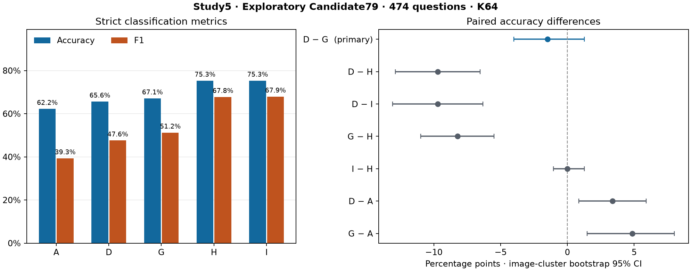

# Study5 — Query Attention and Coverage Ablation

Study4에서 관찰한 D−A 개선을 공간 seed 조건과 후속 토큰 선택 규칙으로 나누어 비교했다. SmolVLM-256M-Instruct를 Visual K64로 제한해 Exploratory Candidate79의 79장·474문항에서 다섯 방법의 GPU 응답 2,370개를 검증했다.

| 방법 | K64 선택 방식 | Strict Accuracy | F1 |
|---|---|---:|---:|
| A | 전역 Coverage64 | 62.24% | 39.32% |
| D | 격자 Query25 + Coverage39 | 65.61% | 47.59% |
| G | 전역 Query25 + Coverage39 | 67.09% | 51.25% |
| H | 전역 Query Top-64 | 75.32% | 67.77% |
| I | 격자 Query25 + 전역 Query39 | 75.32% | 67.95% |

D−G Strict Accuracy의 차이는 **−1.48%p**로, 이미지 단위 paired bootstrap 95% CI는 **[−4.01, +1.27]%p**였다. 동일한 Seed25에서 Query completion은 Coverage completion보다 높은 Accuracy를 기록했다. H와 I는 공동 최고 Accuracy였고 예측은 6문항에서 달랐다. [최종 보고서](docs/STUDY5_FINAL_RESEARCH_REPORT.md) · [한국어 요약](docs/STUDY5_RESEARCH_SUMMARY.md) · [사전 등록](docs/STUDY5_PROTOCOL.md)



## 검증과 재현

저장소 루트에서 아래 명령을 실행한다. Python 3.11과 [CPU 의존성](requirements-cpu.txt)을 사용한다. Torch는 운영체제에 맞는 [PyTorch CPU wheel](https://pytorch.org/get-started/locally/)을 사용할 수 있다. 관측된 원본 버전은 Python 3.11.15, PyTorch 2.13.0+cu126, Transformers 5.15.1이다.

```console
python -m pip install -r study5/requirements-cpu.txt
python -I -B -X utf8 study5/scripts/run_cpu_tests.py
python -I -B -X utf8 study5/scripts/reproduce_candidate79.py
```

CPU 스위트의 토큰 선택, Decoder, 파서, 합성 SQLite 예약·재개 테스트는 공개 폴더만으로 실행할 수 있다. 사전학습 모델, 이미지, 외부 평가 Manifest 없이 실행되며 새 GPU 추론을 시작하지 않는다. A/D 검증에 필요한 Study4 선택기는 `src/`에 함께 들어 있다. 집계 검산은 NumPy와 [이미지 ID를 뺀 혼동행렬 집계](results/image_cluster_counts.csv)로 방법별 지표와 등록된 일곱 비교의 95% 구간을 재현한다. Paired 정오 전환 수는 공개 산출물 간 값이 일치하는지 검사한다. 문항별 원시 응답과 원래 식별자가 있어야 전환 수와 파서 출력을 원점부터 다시 계산할 수 있다.

### GPU 진입점과 입력

- [GPU Smoke](scripts/smoke_gpu.py)는 기존 기능 검증 이미지와 모델 디렉터리를 `--image`, `--snapshot`으로 받는다. 기본값은 해시 검사만 한다. `--run-gpu`로 실제 생성을 시작하며, 사전 검증 이미지의 바이트 해시를 검사한다. 해당 이미지가 필요하고 N832/1088은 같은 작업 폴더에 생성된 N576 완료 기록을 요구한다.
- [후보 평가 Runner](scripts/run_p3b_candidates.py)는 원래 연구의 고정 계층에서 상대경로로 Study4의 `runs/p3b0-dev-20261124/{RESERVE79,DEV100}.json`, Study5의 `evidence/{HOLDOUT79_AUDIT,P3A_CPU}.json`, 그리고 공식 POPE 주석 및 COCO 원본을 읽는다. 평가 데이터, 원래 이미지 경로와의 대응, 실행 Identity와 로컬 모델 snapshot이 원본과 일치해야 한다. 기본값은 계획 확인이며 GPU 실행은 `--run-candidate-gpu`로 명시한다. 두 스크립트는 아카이브된 GPU 절차를 보여 주며 공개본만으로 원래 GPU 평가를 재생할 수 없다.
- 원래 환경은 GTX 1660 SUPER, Batch1 No-Padding, SDPA·FP16, Greedy, 최대 10토큰이다. [모델 snapshot](https://huggingface.co/HuggingFaceTB/SmolVLM-256M-Instruct/tree/7e3e67edbbed1bf9888184d9df282b700a323964) · [POPE](https://github.com/RUCAIBox/POPE) · [COCO](https://cocodataset.org/#download)

## 공개 자료와 해석 범위

[파일 목록](PUBLIC_FILES.md)과 [집계 출처](results/PROVENANCE.json)에 포함 범위를 기록했다. COCO 이미지·POPE 평가 Manifest와 원본 주석·모델 캐시·원시 응답 SQLite·로그·체크포인트·임시 Tensor·개인 경로 및 권리를 확인하지 않은 PDF는 제외했다.

Candidate79의 완전한 독립성은 미확정이다. 단일 SmolVLM, K64, POPE 객체 존재 판별 결과다. Study5는 Full 모델과 직접 비교하지 않았으며 종단간 가속은 검증되지 않았다. 보조 비교에 다중 비교 보정을 적용하지 않았다. Left-Padding FP16 parity BLOCKER가 유지된다. [결과 검증](docs/STUDY5_P3C_RESULTS_REPORT.md) · [기능 검증](docs/STUDY5_P2_GPU_SMOKE_REPORT.md)
