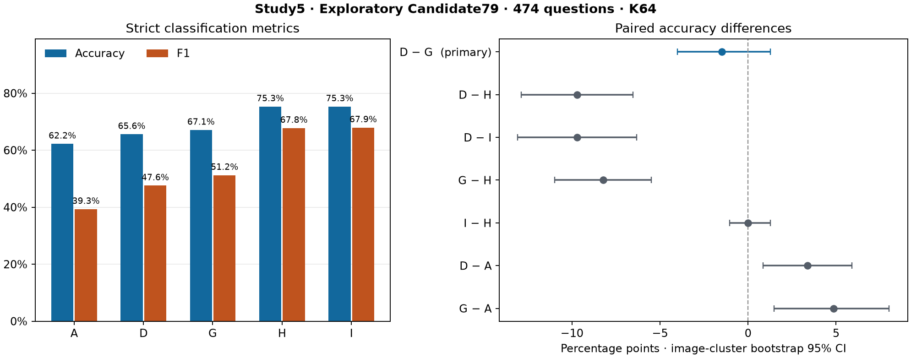

# Study5 최종 연구 보고서 — 질문 Attention과 공간 제약 Ablation

## 초록

Study4의 Grid Query 방식 D가 전역 Coverage 방식 A보다 높았던 결과에서 공간 제약의 기여를 분리했다. SmolVLM-256M-Instruct의 시각 토큰을 K64로 줄인 다섯 방법을 Exploratory Candidate79(79장, 공식 POPE Random 474문항, 저장된 GPU 응답 2,370개)에서 비교했다. 사전 등록 주 비교 D−G의 Strict Accuracy 차이는 −1.48%p(95% CI [−4.01, +1.27]%p)로 격자 seed의 정확도 이점을 확인하지 못했다. 동일한 초기 25개를 공유한 두 보조 비교에서 Query 순위로 나머지 39개를 채운 방법의 정확도가 더 높았다. 전역 Query Top-64인 H와 격자 seed를 더한 I는 75.32%로 Accuracy 공동 최고였고, I의 F1이 67.95%로 가장 높았다. 후보의 완전한 독립성은 미확정이다.

## 1. 연구 배경과 질문

Study4 Dev100에서는 D의 Accuracy가 A보다 3.33%p 높았다. D는 질문 Attention으로 초기 대표를 고르는 방식과 5×5 셀별 보장을 함께 적용한다. Study5는 Query 기반의 최초 25개에서 공간 조건만 바꾸는 D−G를 주 비교로 두고, 초기 집합을 고정한 채 남은 39개의 규칙을 바꾸는 D−I와 G−H를 추가했다. [Study5 사전 등록](STUDY5_PROTOCOL.md) · [Study4 Dev100 비교 원자료](../../study4/results/paired_vs_A.csv)

## 2. 방법과 공통 조건

| 방법 | 첫 선택 | 나머지 선택 |
|---|---|---|
| A | 빈 집합 | 전역 Coverage Greedy64 |
| D | 5×5 셀별 Query Attention Top-1, 총 Seed25 | 같은 seed 상태에서 Coverage Greedy39 |
| G | 전역 Query Attention Top-25 | 같은 seed 상태에서 Coverage Greedy39 |
| H | 전역 Query Attention Top-64 | 단일 순위 선택 |
| I | D와 동일한 격자 Seed25 | 미선택 후보의 전역 Query Attention Top-39 |

첫 Decoder layer의 Q/K probe가 산출한 Question-to-Visual Attention FP32 점수 벡터를 공유한다. D/G/H/I는 원점수로 순위를 매기며 동률에서는 원래 visual ordinal이 낮은 토큰을 우선한다. Coverage는 F(S) = Σᵢ wᵢ maxⱼ∈S max(0, cos(vᵢ,vⱼ) − row_meanᵢ)를 사용한다. v는 Projector 특징, wᵢ는 min–max 정규화한 질문 점수 rᵢ에 대한 exp(0.3rᵢ)이다. D/G는 최초 Seed25가 만든 최대 유사도 상태를 이어받는다. H/I는 최종 선택 후 같은 F(S)로 진단한다.

동일한 모델 snapshot, Processor, Prompt, Visual 후보, 파서, Greedy 최대 10토큰을 적용했다. GTX 1660 SUPER에서 Batch1 No-Padding, SDPA·FP16으로 실행했다. 모든 방법은 시각 토큰 64개를 원래 순서로 정렬하고 비시각 토큰을 보존했다. 첫 LLM Prefill 전에 입력을 압축해 Compact Position과 Native Causal Mask로 Cold-KV에서 시작했다. D/I의 초기 25개와 G/H의 전역 Top-25 prefix가 문항마다 일치했다. [실행 설정](STUDY5_PROTOCOL.md) · [GPU 기능 검증](STUDY5_P2_GPU_SMOKE_REPORT.md)

## 3. 데이터와 무결성

기록상 비중복인 **Exploratory Candidate79**의 이미지마다 공식 POPE Random 질문 6개를 사용했다. 공식 정답은 Yes/No 각 237개다. 방법당 N832 432문항, N1088 42문항이다. 과거 사용 기록이 남지 않은 입력이 있어 완전한 독립성은 미확정이다.

SQLite를 읽기 전용으로 열어 다섯 방법 각각 474개의 완료 응답, 16개 완료 Chunk, Manifest·Config·실행 Identity 해시 및 완료 레코드를 확인했다. 누락·중복·오류 이벤트가 각각 0건이었고, 로그·실행 Identity·GPU 진단에서 Mock 혼합 징후가 없었다. Raw Response에서 두 파서를 다시 실행한 결과 Invalid와 파서 간 판정 차이는 모두 0건이다. 기존 집계와 지표·bootstrap 결과 및 payload 해시가 일치했다. 2,370개 기존 GPU 결과만 사용했다. [P3C 검증 및 해시](STUDY5_P3C_RESULTS_REPORT.md) · [집계](../results/candidate_summary.json) · [공개용 출처 해시](../results/PROVENANCE.json)

## 4. 성능과 사전 등록 비교

Yes를 양성 클래스로 사용했다. Recall 분모는 실제 해당 라벨 전체다. Strict와 Official-compatible의 지표는 이번 응답에서 일치했다.

| 방법 | Accuracy | Precision | Yes Recall | No Recall | F1 | TP | TN | FP | FN | 정답 수 |
| --- | ---: | ---: | ---: | ---: | ---: | ---: | ---: | ---: | ---: | ---: |
| A | 62.24% | 100.00% | 24.47% | 100.00% | 39.32% | 58 | 237 | 0 | 179 | 295 |
| D | 65.61% | 100.00% | 31.22% | 100.00% | 47.59% | 74 | 237 | 0 | 163 | 311 |
| G | 67.09% | 98.80% | 34.60% | 99.58% | 51.25% | 82 | 236 | 1 | 155 | 318 |
| H | 75.32% | 97.62% | 51.90% | 98.73% | 67.77% | 123 | 234 | 3 | 114 | 357 |
| I | 75.32% | 96.88% | 52.32% | 98.31% | 67.95% | 124 | 233 | 4 | 113 | 357 |

차이와 신뢰구간의 단위는 %p이며 앞 방법에서 뒤 방법을 뺀다. 전환은 뒤 방법에서 앞 방법으로 바꿨을 때의 문항 수다. 79개 이미지의 6문항을 각각 한 cluster로 유지하고 동일한 이미지 인덱스를 모든 방법에 짝지어 10,000회 복원추출했다. seed는 20261126, 구간은 선형 보간한 양측 95% percentile이다. **D−G Strict Accuracy**만 주 비교다. 보조 비교 구간은 다중 비교 보정 없이 탐색적으로 해석한다.

| 비교 | Accuracy 차이 | Accuracy 95% CI | F1 차이 | F1 95% CI | 정답→오답 | 오답→정답 |
| --- | ---: | ---: | ---: | ---: | ---: | ---: |
| D−G | −1.48 | [−4.01, +1.27] | −3.66 | [−9.65, +2.37] | 26 | 19 |
| D−H | −9.70 | [−12.87, −6.54] | −20.18 | [−26.80, −13.78] | 61 | 15 |
| D−I | −9.70 | [−13.08, −6.33] | −20.36 | [−27.20, −13.70] | 61 | 15 |
| G−H | −8.23 | [−10.97, −5.49] | −16.52 | [−22.27, −10.97] | 54 | 15 |
| I−H | 0.00 | [−1.05, +1.27] | +0.18 | [−1.57, +2.29] | 3 | 3 |
| D−A | +3.38 | [+0.84, +5.91] | +8.27 | [+1.97, +14.57] | 17 | 33 |
| G−A | +4.85 | [+1.48, +8.02] | +11.93 | [+4.27, +19.50] | 19 | 42 |

D−G의 점추정은 G 쪽이며 구간은 0을 포함한다. I−H에서도 격자 seed의 정확도 이점은 관찰되지 않았고, 신뢰구간은 작은 이득과 손실을 모두 허용한다. D−I와 G−H는 각각 격자 seed, 전역 seed가 동일한 대비다. 두 대비에서 Query completion의 Accuracy가 각각 9.70%p, 8.23%p 높았다. D−H는 seed 배치와 completion을 함께 바꾼다.

## 5. H와 I의 정확도 동률

H와 I는 각각 357/474문항을 맞혔다. 예측이 달랐던 **6문항은 5장**에 분포했다. I는 그중 Yes 3개를 추가로 맞혔고, H가 맞힌 Yes 2개와 No 1개를 틀렸다. 합계로 I는 H보다 TP와 FP가 각각 1개 많다. 정답 수는 같으며 I−H F1은 +0.18%p(95% CI [−1.57, +2.29]%p)였다.

| 사례 | 공식 라벨 | H | I | 맞힌 방법 | 공통 토큰 / 64 |
| --- | ---: | ---: | ---: | ---: | ---: |
| 1 | yes | yes | no | H | 63 |
| 2 | no | no | yes | H | 63 |
| 3 | yes | no | yes | I | 57 |
| 4 | yes | no | yes | I | 57 |
| 5 | yes | yes | no | H | 63 |
| 6 | yes | no | yes | I | 63 |

최종 Visual 선택은 평균 61.85/64개를 공유했고 최소 57개를 공유했다. 52문항에서 선택 집합이 같았다. 원문 응답과 생성 ID는 각각 468/474문항에서 일치했다. 위 6문항은 모두 선택 집합이 달랐다. 이 차이만으로 각 문항에서 어떤 토큰이 답변을 바꿨는지 특정할 수 없다.

## 6. 공간 점유와 Coverage

5×5 셀 점유는 저장된 최종 선택 토큰 좌표에서 계산했다. HHI는 문항별로 각 셀의 토큰 비중을 제곱해 더한 뒤 문항 평균을 낸 값이며 클수록 집중도가 높다. H 교집합은 같은 문항의 전역 Query Top-64에서 해당 방법이 보존한 토큰 수다.

| 방법 | 평균 점유 셀 / 25 | 점유 범위 | 25셀 모두 점유 / 474 | 최다 점유 셀 토큰 중앙값 / 최대 | 평균 HHI | 평균 F(S) | H와 평균 교집합 / 64 |
| --- | ---: | ---: | ---: | ---: | ---: | ---: | ---: |
| A | 23.22 | 20–25 | 72 | 6 / 10 | 0.0538 | 154.79 | 5.88 |
| D | 25.00 | 25–25 | 474 | 5 / 9 | 0.0486 | 150.62 | 23.97 |
| G | 23.14 | 20–25 | 28 | 7 / 12 | 0.0580 | 150.50 | 25.77 |
| H | 22.85 | 18–25 | 52 | 11 / 20 | 0.0761 | 120.18 | 64.00 |
| I | 25.00 | 25–25 | 474 | 11 / 16 | 0.0699 | 119.91 | 61.85 |

H와 I는 최다 점유 셀에 평균 11.87개와 11.14개를 담았다. I는 모든 셀을 채웠으며, H는 18~25개 셀을 채웠다. H는 비교군 중 HHI가 가장 컸다. 최초 25개의 점유는 D/I에서 25개, G에서 평균 13.05개였다. D/G는 최종 평균 40.96/64개를 공유했고 D/I는 25.99/64개를 공유했다. 격자 제약으로 점유가 달라졌으나 두 completion 조건 모두에서 Accuracy 이점은 확인되지 않았다. [전체 쌍별 토큰 교집합](STUDY5_P3C_RESULTS_REPORT.md#4-coverage-공간-분포-선택-교집합)

저장된 문항별 F(S)와 정오(정답 1, 오답 0)의 Pearson r을 방법별로 계산했다. 두 번째 상관은 N832/N1088과 공식 Yes/No를 조합한 네 층에서 F(S)와 정오의 평균을 각각 뺀 뒤 계산했다. 두 값은 기술 통계다. 이미지 내 6문항의 종속성을 고려한 추가 추론이나 독립 표본에서의 예측 검증은 수행하지 않았다.

| 방법 | F(S)와 정오의 상관 r | 토큰 수·라벨 층 내 중심화 후 r |
| --- | ---: | ---: |
| A | -0.019 | 0.042 |
| D | -0.038 | 0.007 |
| G | 0.022 | 0.125 |
| H | -0.005 | 0.050 |
| I | -0.010 | 0.042 |

A는 가장 높은 평균 F(S)와 가장 낮은 Accuracy를 기록했다. D의 Coverage는 I보다 474문항 모두에서 높았지만 그중 I만 맞힌 문항은 61개, D만 맞힌 문항은 15개였다. G의 Coverage 역시 H보다 474문항 모두에서 높았고 H만 맞힌 문항은 54개, G만 맞힌 문항은 15개였다. 방법 내 상관과 짝지은 관측을 함께 보면 높은 Coverage를 이 평가의 정답률 대용 지표로 사용하기 어렵다.

## 7. 오류 사례와 가능한 설명

Coverage completion인 D/G에서 FN은 163/155건, 같은 초기 집합에서 Query completion을 한 I/H에서는 113/114건이었다. D→I의 순변화는 FN 50건 감소와 FP 4건 증가, G→H는 FN 41건 감소와 FP 2건 증가다. 따라서 이번 Accuracy 차이의 주된 산술적 원인은 양성 검출 회복이다. 두 대비 모두 Query 방식에서 일부 역전과 No 문항의 오탐도 발생했다.

아래는 각 대비에서 **공식 라벨과 정오 전환 방향의 조합마다 고정 Manifest 순서에서 가장 먼저 나온 문항**이다. D−I에서는 공식 No에 대해 I만 맞힌 문항이 없었다. 공식 라벨과 객체 범주를 표시했다. 공개판에서는 문항 및 이미지 식별자를 제거했다.

| 비교 | 사례 | 객체 범주 | 공식 라벨 | 응답 순서 | Coverage F(S) |
| --- | ---: | ---: | ---: | ---: | ---: |
| D−I | 익명 | traffic light | yes | no / yes | 150.96 / 121.91 |
| D−I | 익명 | sports ball | yes | yes / no | 151.62 / 128.96 |
| D−I | 익명 | bed | no | no / yes | 152.33 / 115.02 |
| G−H | 익명 | traffic light | yes | no / yes | 151.86 / 122.40 |
| G−H | 익명 | sports ball | yes | yes / no | 151.68 / 128.84 |
| G−H | 익명 | wine glass | no | no / yes | 151.28 / 119.67 |
| G−H | 익명 | person | no | yes / no | 149.30 / 117.94 |

가령 신호등 문항에서는 Coverage가 높은 D/G가 No, I/H가 Yes였다. 스포츠 공 문항에서는 Coverage가 높은 D/G가 정답을 맞혔다. 저장된 선택 기록에서 Query completion은 전역 Query Top-64를 훨씬 더 많이 보존한다. K64에서 그 순위의 토큰을 더 남기는 정책이 질문과 관련된 객체 단서를 보존했을 가능성이 있다. Coverage는 질문 가중치를 쓰더라도 개별 후보의 Attention 순위보다, 현재 선택 집합에 추가했을 때 전체 특징 공간에서 새로 대표되는 양을 평가한다. 같은 증거를 가진 토큰들이 서로 유사할 경우 두 기준은 다른 선택을 할 수 있다. 이번 기록에는 토큰과 객체 위치를 직접 연결한 검증이 없어 해당 메커니즘은 가설로 남는다.

## 8. Study4 해석의 갱신

Study4 Dev100에서 D−A Accuracy는 +3.33%p(95% CI [+0.67, +6.17]%p), F1은 +7.32%p였다. Candidate79에서도 D−A Accuracy +3.38%p, F1 +8.27%p로 방향이 같았다. Study5에서는 공간 제약 없이 Query seed를 적용한 G도 A를 앞섰고, D−G와 I−H에서는 격자의 추가 Accuracy 이점이 확인되지 않았다. 따라서 Study4의 관측은 질문 기반 선택을 활용하는 정책의 개선으로 해석할 수 있으며, 격자 자체의 독립적 개선을 입증하는 근거로는 부족하다. [Study4 D−A 원자료](../../study4/results/paired_vs_A.csv) · [Study4 구간](../../study4/results/cluster_bootstrap.csv)

## 9. 한계와 후속 연구

- Candidate79는 기록상 비중복인 탐색 후보이며 과거 노출 이력 일부는 확인할 수 없다.
- SmolVLM 단일 모델, K64 단일 예산, POPE Random의 이진 객체 존재 판단에 국한된다. Study5에서는 비압축 Full 모델과 직접 비교하지 않았다.
- 후보79 실행에는 Latency와 GPU Peak Memory가 저장되지 않았다. 기능 Smoke의 계측은 별도 조건이다. End-to-End 속도 개선은 미검증이다.
- 보조 비교와 추가 오류 분석은 탐색적이며 다중 비교를 보정하지 않았다. 높은 No Recall에도 H/I는 237개 Yes 중 각각 114/113개를 놓쳤다.
- Left-Padding FP16 parity BLOCKER가 유지된다. 이번 결과의 실행 범위는 Batch1 No-Padding이다.
- 독립 표본에서 같은 대비를 검증하고, 복수 예산·모델에서 재현성과 Full 대비 절충을 측정할 수 있다. 객체 위치 주석과 선택 토큰을 연결하면 질문 관련 단서 보존 가설을 직접 검증할 수 있다.

## 10. 결론

H는 전역 Query Top-64의 단일 순위 선택으로 I와 공동 최고 정확도 75.32%를 기록했다. I의 F1이 0.18%p 높았고, 두 방법의 Accuracy와 F1 차이 구간은 모두 0을 포함했다. 동일 seed의 두 비교에서 Query completion이 Coverage completion보다 높았으며, 공간 제약의 추가 Accuracy 이점은 확인하지 못했다. 결과는 Exploratory Candidate79에서의 K64 비교로 범위를 한정한다.
